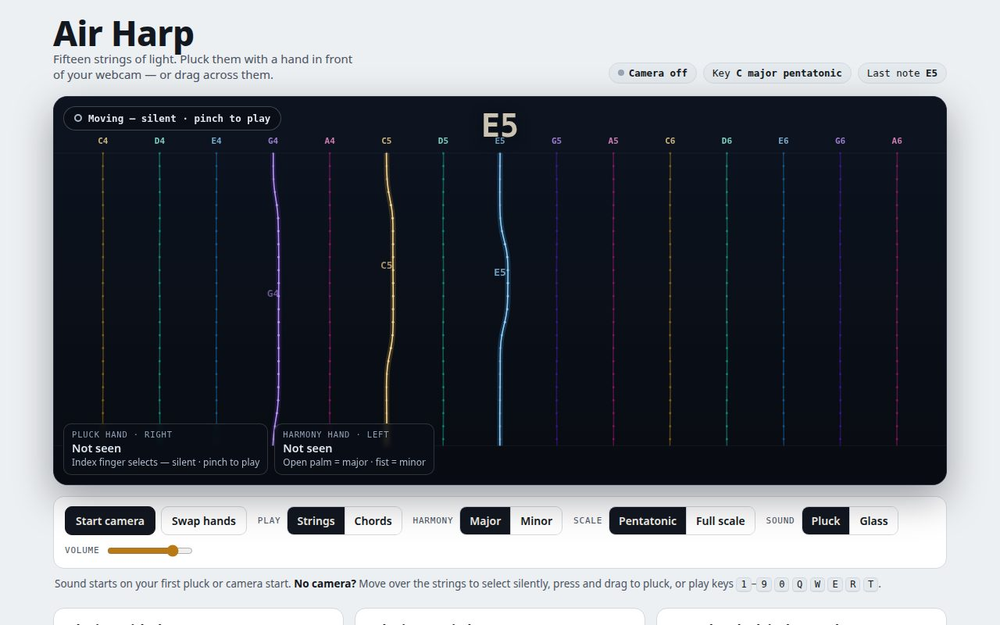
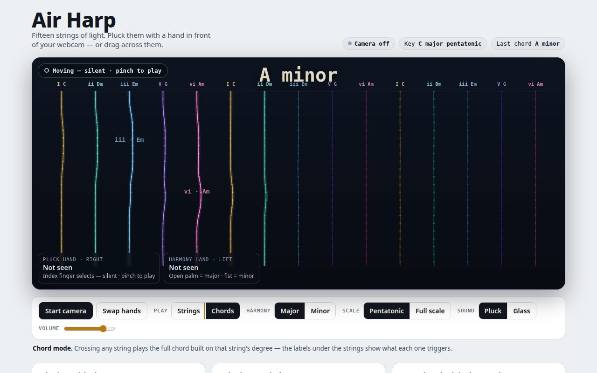

# Air Harp

A webcam air harp: pluck particle strings on screen with your hands to make music — one hand plays, the other hand bends the harmony between major and minor. Chord mode included.

Open `index.html` in a browser (Chrome works best), allow camera access, and play. No build step, no server, nothing to install. Hand tracking runs in your browser on your own machine; video is not sent anywhere.

## Screenshots

Strings mode — pluck individual strings. The badge at the top of the stage shows the clutch state ("Moving — silent · pinch to play"), the big readout is the last note played, and the two cards track each hand's job:

Chord mode — the strings are labelled with the chord each one plays (I C, ii Dm, iii Em, V G, vi Am…), and crossing a string plays that whole chord:

## How to play

The harp has 15 particle strings, laid out left to right as scale degrees in C, so anything you strum lands in key.

**The split that makes it playable: selecting is silent, playing takes a pinch.**

- **Move (no pinch) — silent.** Your pluck hand's index fingertip selects: the string under it lights up, but passing over strings makes no sound. Your other fingers trigger nothing. Move your hand anywhere, get into position, take your time.
- **Pinch — play.** Hold a thumb-to-index pinch and the pinch point becomes a pick. Sweep it across strings to pluck them; how fast you cross sets how loud. Release the pinch and you are silent again. A badge on stage always shows which state you are in: "Moving — silent" or "Pinching — playing".
- **Harmony hand (the other hand, whole-hand shapes only).** Open palm = major, fist = minor — the strings retune when it flips. Pinch = sustain. Hand height = brightness.
- **Chord mode.** Switch Play from Strings to Chords: every string is labelled with its chord (I, ii, iii, IV, V, vi, vii°) and plucking a string plays that full diatonic chord as a quick strum instead of a single note — in a major key the ii and iii chords come out minor and vii diminished, and flipping the harmony hand to minor rebuilds all the chords in the minor key.
- **No camera handy:** mouse and touch follow the same rule — hover selects silently, a pressed drag plays. Keys 1–0 and Q–T play the strings directly.

Plucking uses segment-crossing detection: a string fires when the pick's *path* crosses it (so fast strums register), with velocity taken from crossing speed, an 80 ms per-string cooldown, and a re-arm rule so one crossing never double-fires. Strings are never draggable — a pluck only starts a vibration around a string's fixed home, capped well under the distance to the next string, so strings can't warp into each other.

## Status

Working prototype, tested live by its maker on a real webcam (Oct 30, 2026). v1 fixes already in, from that first live test: strings no longer warp/drag, and the pinch clutch above replaced trigger-on-any-touch after every finger was firing every string it passed.

**Next phase:** conducting — watch the player conduct to set the backing tempo (beat = the low point of the right hand, tempo from the intervals between beats) and propose a time signature, which the research says to treat carefully: tempo detection is reliable, time-signature classification only works for textbook patterns, so meter changes will be confirmed by the player, not switched silently.

## Design notes

This project came out of a research pass over gesture-controlled instruments (Theremin, Reactable, Imogen Heap's Mi.Mu gloves, Leap Motion's AirHarp, Google's Play a Kandinsky, PIXELSYNTH) and the current open-source crop — Gesture Synth and Vivomusicano especially, for their bimanual chord grammar, progression handling, and anti-flicker tuning (pose stability windows, cooldowns, hold-last-value on hand loss). The combination here — one hand plucking visual strings while the other hand live-toggles major/minor, plus a conducting-set clock — didn't turn up in any existing project in that research.

Sound is a Karplus-Strong plucked-string model (with a glass-synth option) synthesized in the browser. Tracking is MediaPipe Hand Landmarker, also in the browser.

Conducting method reference: Salgian, Burke & Ernest, "Visual Analysis of Conducting Gestures" (ICMC 2025).

## Files

- `index.html` — the whole instrument, one self-contained file.
- `README.md` — this file.
